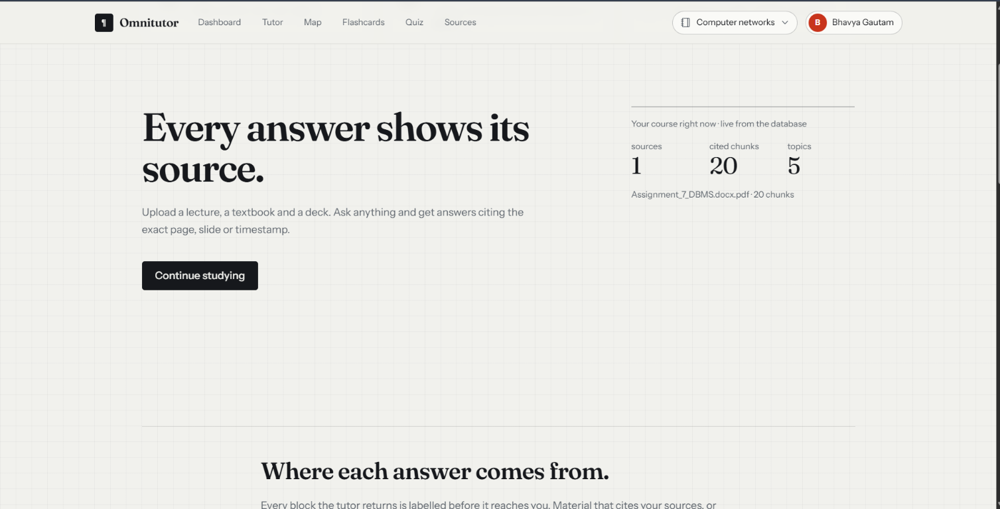
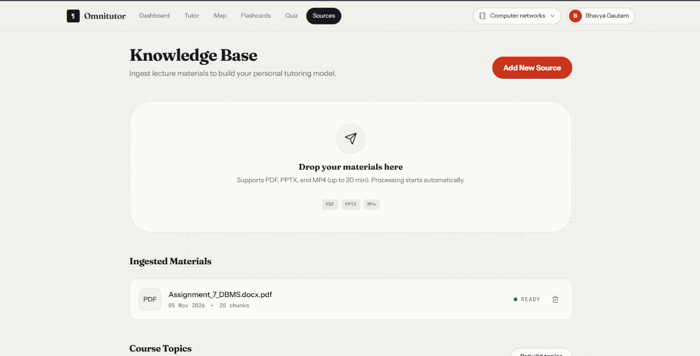
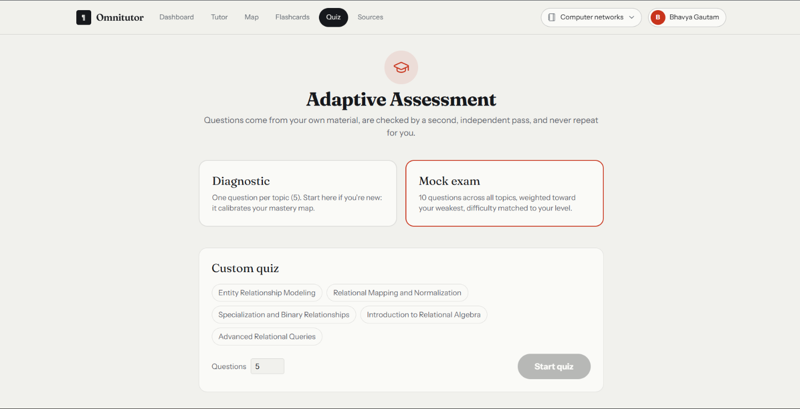
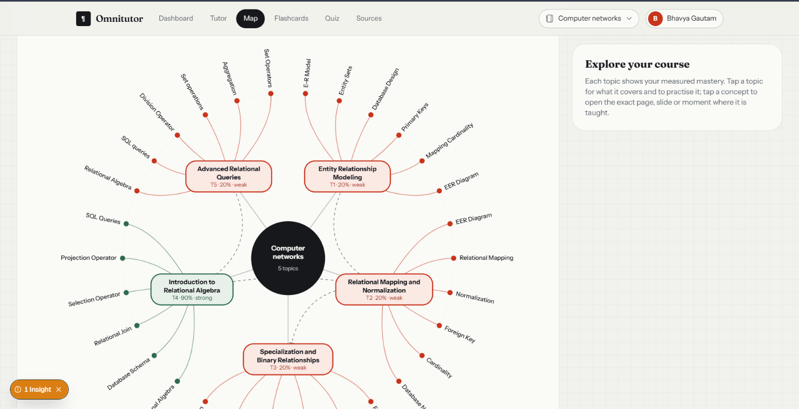
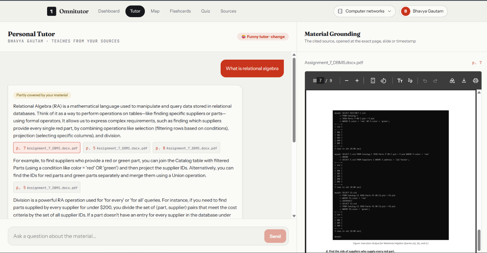
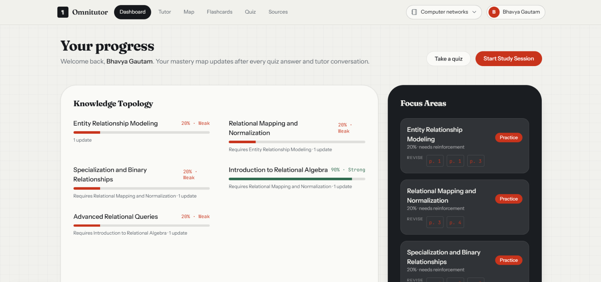
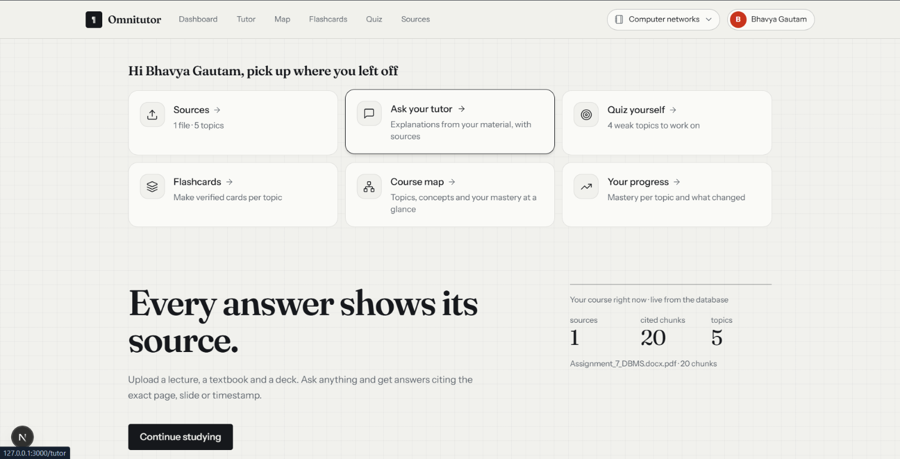
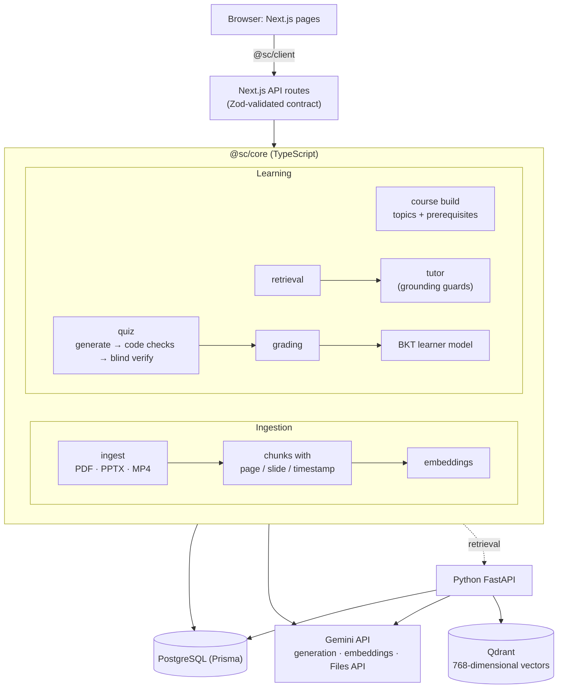

# Omnitutor: a study companion grounded in your own course material

**IIT Mandi Multimodal AI Hackathon 2026, Track D: Personalized Tutoring & Adaptive Learning**

> **Judges:** start with [docs/JUDGES.md](docs/JUDGES.md): a 10-minute tour, each Track D requirement mapped to code and measured results, and a map of the docs.

Upload a lecture **video**, a **textbook PDF** and a **slide deck**. Omnitutor turns them into a source-cited knowledge base and uses it to:

- **Tutor you.** Every claim cites the exact **page, slide or timestamp**, which opens beside the answer. Questions your material doesn't cover are declined, and anything from outside your sources is labelled as such.
- **Quiz you adaptively.**
  - MCQ, short-answer and numerical questions are generated from your material and **checked by a second, blind model pass**.
  - They never repeat for you, and they're weighted toward your weak topics at a difficulty matched to your level.
  - Every answer gets **cited feedback**, and each quiz ends in a report with weak topics and likely misconceptions.
- **Model you as a learner.** Per-topic mastery uses Bayesian Knowledge Tracing and updates after **every quiz answer and every tutor conversation**. New learners start with a diagnostic.

## Prerequisites

- **Node.js** ≥ 20.12 (developed on 24) and npm
- **Python** ≥ 3.12 and [uv](https://docs.astral.sh/uv/)
- **Docker Desktop**, which runs PostgreSQL and local Qdrant
- A **Gemini API key** from [Google AI Studio](https://aistudio.google.com/apikey). The free tier works.

## Setup and run

```bash
npm install
cp .env.example .env        # then set APP_GEMINI_API_KEY (or several keys, see below) and the model IDs
npm run db:up               # PostgreSQL on localhost:5434
docker compose --profile vector up -d qdrant
npm run db:deploy           # apply the database migrations
npm run db:seed             # optional: shared demo course used by the eval tools and tests
```

Set up and start the Python API:

```powershell
Set-Location services\api
uv sync --extra dev
uv run uvicorn app.main:app --host 127.0.0.1 --port 8012 --reload
```

The root `.env.example` configures the local Python API and Qdrant URLs. For a minimal setup, also
set `SESSION_SECRET` to a random value of at least 32 characters; both services must use the same
secret. See [docs/ENVIRONMENT_VARIABLES.md](docs/ENVIRONMENT_VARIABLES.md) for which variables
belong on each service.

Start the web app in another terminal from the repository root:

```bash
npm run dev
```

Production mode: `npm run build && npm run start -w @sc/web`.

**Deployment status:** the current app uses local disk for uploaded originals and in-process
background ingestion, so serverless/ephemeral deployments are not supported and it is not ready for
unattended public production use. Read [docs/DEPLOYMENT.md](docs/DEPLOYMENT.md) before hosting it.

Then open http://localhost:3000, **create an account** and answer the four onboarding questions. Sample material: use any lecture PDF, `.pptx` deck and `.mp4` (up to 20 min) of your own. Our evaluation files are third-party course material and are not redistributed ([data/demo/README.md](data/demo/README.md)).

Windows: stop the dev server before `npm install` or `npm run db:generate` (Prisma's engine DLL is locked while it runs).

**Health check:** `GET http://localhost:3000/api/health` returns `{"ok": true, ...}`. Add `?gemini=1` to check the key and every model; this spends no tokens.

### Configuration (`.env`)

| Variable | Meaning |
|---|---|
| `APP_GEMINI_API_KEY` | one Gemini key |
| `APP_GEMINI_API_KEYS` | optional: several keys, comma-separated. When one hits its quota or is rejected (invalid/revoked), calls move to the next, and the built-in rate limits scale with the number of keys |
| `LLM_MODEL_FAST` / `LLM_MODEL_STRONG` | generation models (bulk extraction + grading / tutor, quiz generation, video, course build) |
| `LLM_MODEL_VERIFY` | the **different** model that blindly re-answers every generated quiz question (**cross-model validation**); we use `gemini-3.5-flash-lite` against `gemini-3.1-flash-lite` for generation |
| `LLM_MODEL_FALLBACK` | optional: used when a model is overloaded or out of quota on every key (default: whichever of `LLM_MODEL_VERIFY` / `LLM_MODEL_FAST` differs from the failing model) |
| `EMBED_MODEL` | embedding model (`gemini-embedding-001`, 768 dimensions) |
| `LLM_TIMEOUT_MS` | optional: per-request timeout for Gemini calls (default 120000); a timed-out call is retried once |
| `SESSION_SECRET` | optional, ≥32 chars; signs login cookies. If unset, a random secret is generated once into `data/cache/session-secret` |
| `REFUSAL_TAU` | retrieval similarity floor below which the tutor declines without calling the LLM (we use 0.60) |
| `COURSE_NAME` | name of the default course; it's given to every prompt as context |
| `PYTHON_API_URL` | HTTPS origin of the Python retrieval API in deployment; loopback HTTP for local development |
| `QDRANT_URL` / `QDRANT_API_KEY` | Qdrant endpoint and optional access key; used by the Python API |
| `QDRANT_COLLECTION` / `QDRANT_VECTOR_SIZE` | Python vector collection and dimensions (768) |

The complete web/Python environment-variable map is in
[docs/ENVIRONMENT_VARIABLES.md](docs/ENVIRONMENT_VARIABLES.md).

## Using it

1. **Sign up and onboarding:** four questions set the tutor's personality, explanation style, your level and your goal.
2. **Sources:** drop a PDF, a `.pptx` and an `.mp4` (up to 20 min) into the active notebook. Processing starts automatically and you can watch the progress. Then click **Build topics**.
3. **Quiz → Diagnostic:** one question per topic, to calibrate your mastery map. Then custom quizzes on topics you pick, or a mock exam.
4. **Tutor:** ask questions. Click a citation chip to open the PDF at that page, the video at that second, or the slide. Your conversation is saved per notebook.
5. **Quiz report:** your score, mastery before → after per topic, misconceptions, cited feedback, and what to revisit.
6. **Dashboard, Map, Flashcards:** mastery per topic with prerequisites and history; the course mind map; verified, cited flashcards with spaced repetition.
7. **Evaluation:** the measured metrics (below), read from `data/eval/`.

Sign in (or create an account) from the header. **Each account has its own private notebooks** (one per subject): the files uploaded to a notebook, its topics, tutor history, quizzes, flashcards and mastery are visible only to that account. The server enforces this on every route (a signed HttpOnly session cookie; another account's course, file or data returns 401). Passwords are hashed with scrypt. Requests without a session (the eval scripts and e2e tests) use the shared demo course.

## Features at a glance

- **Private accounts and notebooks:** each student signs in; every notebook (one per subject) has its own files, topics, tutor history, quizzes, flashcards and mastery, enforced on the server.
- **Onboarding:** four quick questions set the tutor's personality (friendly, funny, serious or concise; also the sampling temperature), explanation style, level and goal.
- **A tutor that teaches:** explains in its own words with citations that open the exact PDF page, slide or video second; outside knowledge is labelled; off-material questions are declined or flagged.
- **Course map:** an interactive mind map of topics, prerequisites and concepts, coloured by the student's measured mastery; every concept opens its source.
- **Flashcards:** generated per topic from the topic's own excerpts, each checked by a second model and cited; spaced repetition (Leitner boxes); reviews update mastery.
- **Verified quizzes and reports:** MCQ, short-answer and numerical questions verified by a second model, no repeats, cited feedback, misconceptions.
- **Dashboard and study hub:** per-topic mastery from quizzes, tutor chats and flashcards; the home page shows what to do next.
- **Evaluation page:** the measured RAGAS-style metrics and simulated-student results.

## Screenshots and how the app works

The screenshots below follow the main study workflow, from opening a course to reviewing progress.

### Course home



The course home introduces Omnitutor's core promise: answers are grounded in the learner's own material and cite where information came from. The course summary on the right reports live counts for uploaded sources, indexed chunks and detected topics, so learners can see what the tutor has available before continuing to study.

### Sources library



The Sources page is where learners add PDFs, PowerPoint decks and videos up to 20 minutes long. Dropping a file starts ingestion automatically: Omnitutor extracts or transcribes its content, divides it into citable chunks and indexes it for retrieval. The ingested-materials list shows each file's processing status and chunk count; course topics can then be built from the available sources.

### Adaptive quiz setup



The quiz setup offers three ways to practise. A **Diagnostic** samples one question per topic to establish an initial mastery estimate. A **Mock exam** draws questions across topics, emphasizing weaker areas and matching difficulty to the learner's level. A **Custom quiz** lets learners select topics and a question count. Questions are generated from course material, checked by a separate model, and tracked to avoid repeats.

### Course map



The map visualizes a course as a central node connected to its topics and the concepts within them. Mastery colors make strengths and gaps visible at a glance: green indicates stronger topics, while red marks areas that need practice. Selecting a topic helps the learner practise it; selecting a concept opens the material that teaches it, connecting the map back to source pages or slides.

### Grounded tutor



Learners ask a question in the tutor panel and receive an explanation grounded in retrieved course excerpts. Citation chips identify the supporting source and page; selecting one opens that location in the adjacent material viewer, as shown here with page 7 of the PDF. This side-by-side view lets learners verify an explanation against the original material while continuing the conversation.

### Progress dashboard



The dashboard summarizes measured mastery for every topic and highlights focus areas that need reinforcement. Mastery changes as the learner answers quiz questions and talks with the tutor; prerequisite relationships help explain why some topics depend on others. Practice and source-page suggestions turn the mastery summary into a concrete next step.

### Study hub



The study hub is the navigation point for a learner returning to a course. Its cards link directly to the source library, tutor, quizzes, flashcards, course map and progress dashboard, with short descriptions of each activity. The course summary below keeps key context—such as the number of sources and topics—visible while learners decide what to do next.

## How it works



- **Python retrieval (incremental backend):** the web service forwards authenticated notebook
  searches to the Python API; Python embeds the query and searches Qdrant, then rechecks ownership,
  source readiness, chunk text, and citations against PostgreSQL. See
  [services/api/README.md](services/api/README.md).
- **Ingestion is multimodal, with no manual preprocessing.**
  - **PDF:** each page goes to Gemini as an image + text, so scanned and image-only pages and figures work. Figures become their own cited chunks.
  - **PPTX:** slide order and exact text, tables, SmartArt and speaker notes come straight from the file's XML. Pictures go to Gemini for descriptions. One chunk per slide.
  - **Video:** processed in ≤60 s windows through the Gemini Files API, with transcript + on-screen content and accurate timestamps.
- **Retrieval:** embed the question → cosine similarity over the course's chunks (exact search) → top 6.
- **Grounded tutor:** one structured call returns coverage + blocks labelled `material` (citing excerpt IDs) or `outside`. The **server enforces grounding**:
  - citations that weren't retrieved are dropped;
  - uncited "material" claims are relabelled as outside knowledge;
  - "not covered", or no surviving material, means a refusal.

  Uploaded text and student answers are treated as data, never as instructions.
- **Learner model:** BKT per topic (prior 0.3, learn 0.15, slip 0.1, guess MCQ 0.25 / short 0.1 / numeric 0.05). Chat evidence counts at 30% weight. Mastery bands drive question difficulty.
- **Quiz integrity:**
  - **no repeats:** stem hashes are compared against everything the learner has seen;
  - **topic tagging:** every question must cite excerpts of its own topic;
  - **blind cross-model verification:** a *different* model answers each MCQ and numeric question without the key, compared in code (±1%), and checks short reference answers against their sources. In our runs it rejected 6 of 30 mock-exam candidates as not answerable from the sources;
  - **short-answer grading:** includes an alignment check, so a grade always belongs to the right answer;
  - **one grading per quiz:** a submit claims the quiz atomically, so a double click or a second tab can't grade it twice.
- **Topics, concepts and prerequisites:** the course build groups the material into 5–8 topics with prerequisite links; each topic lists its concepts (subtopics), merged from the concept labels found during ingestion, each linked to where it is taught. Sources added later are tagged to the nearest existing topic automatically (rebuild to re-plan the topics).

Details: [docs/ARCHITECTURE.md](docs/ARCHITECTURE.md) · deployment: [docs/DEPLOYMENT.md](docs/DEPLOYMENT.md) · environment variables: [docs/ENVIRONMENT_VARIABLES.md](docs/ENVIRONMENT_VARIABLES.md) · API contract: [docs/API_SPEC.md](docs/API_SPEC.md) · ingestion: [docs/INGESTION_SPEC.md](docs/INGESTION_SPEC.md) · every test run with its numbers: [docs/PROGRESS.md](docs/PROGRESS.md).

## Evaluation (team-built test sets, real Gemini)

Results are shown in the app on the **Evaluation** page (reports in `data/eval/`, regenerated with `npm run eval:rag` and `npm run eval:sim`).

Test sets (58 questions, all in `data/demo/testset.*.json`):
- **Stage-1:** 15 questions: 8 from real IIIT Nagpur OS exam papers, 7 written from the material.
- **Holdout:** 36 questions written *after* retrieval was frozen: 4 verbatim exam questions, 16 new, and 16 off-material (unrelated, same course but not covered, and near-miss).
- **Slides:** 7 questions on a team-made (synthetic) 10-slide deck; each also accepts the lecture-note page with the same fact.

Latest run (2026-10-15, current tutor with the teaching prompt; tutor `gemini-3.1-flash-lite`, judged by a different model, `gemini-3.5-flash-lite`):

| Metric | All | PDF | Slides | Video |
|---|---|---|---|---|
| Faithfulness (claims in the cited part supported by the retrieved excerpts) | **0.95** | 0.96 | 0.86 | 1.00 |
| Answer relevancy | **0.85** | 0.85 | 0.85 | 0.85 |
| Context precision / recall | **0.92 / 0.94** | 0.93 / 0.93 | 0.97 / 0.90 | 0.87 / 1.00 |
| Citation accuracy (cites an expected page/slide/time) | **1.00** | 1.00 | 1.00 | 1.00 |

Off-material: **17 of 21 declined**; the other 4 (numerical problems for algorithms the material doesn't teach) were answered but flagged *partly covered*, with the uncovered part labelled outside knowledge. **0 of 37** answerable questions wrongly declined; refusal precision 1.00. Faithfulness over the whole answer (including the labelled outside-knowledge teaching) is 0.61, as expected for a tutor that adds analogies and examples. Earlier: retrieval hit@1 on the holdout 95% (random ranking: 10%); extraction ground truth PDF 47/47, PPTX 21/21 + 15/15, video 12/12 facts.

**Faithfulness, relevancy and context precision/recall** use the **RAGAS metric definitions**, computed with a Gemini judge that is a different model from the tutor's (`npm run eval:rag`); not the ragas package itself.

**Simulated students** (`npm run eval:sim`): 4 hidden-knowledge profiles × 500 students × 3 sessions, the app's own question selection and mastery model against random quizzing. The simulated students follow a *different* learning model than the app assumes.

| | Adaptive | Random |
|---|---|---|
| Topics learned (novice / basics-only) | **73% / 48%** | 64% / 41% |
| Mastery estimation error after 3 sessions | **lower in all 4 profiles** | |
| Question repetition rate | **0%** | 30% |

**Reproduce:** `npm run test` (unit + DB), `npm run test:e2e` (against a running server; spends no quota), `npm run eval:rag` / `npm run eval:sim`, and the real-data checks in `tools/e2e` (`stage1:*`, `holdout:*`).

## Honest limitations

- **Simple accounts.** Name + password with a signed session cookie; no email verification, password reset or roles. Each account's notebooks are private; requests without a session use the shared demo course. Learners created through `POST /api/learners` (used by the eval tools and tests) have no password and stay open.
- **RAG metrics:** they use the RAGAS definitions with a Gemini judge from the same model family, not the `ragas` package itself. The test set is small and team-built.
- **Speech:** transcription is done by Gemini (no separate speech-recognition engine). Word accuracy on our real lecture video hasn't been measured against a human transcript.
- **Slides:** diagrams drawn with PowerPoint shapes (not pictures) lose their layout. Charts aren't extracted (they're noted in the slide chunk).
- **Retrieval:** dense search only (no keyword/hybrid search or reranking); weakest on pages of source code.
- **Topics:** topics + prerequisites + concepts (concepts are grouped labels, not a planned hierarchy). On our demo course, 79% of sampled chunks were tagged to the expected topic.
- **Security:** signed-in actions are limited to the account's own notebooks, but requests without a session act on the shared demo course (used by the eval tools and tests), and login attempts aren't rate-limited. Fine for a local, single-machine demo; not hardened for a shared server.
- **Other:** old `.ppt`, images and URLs are not accepted.

## Repo layout

| Path | Contents |
|---|---|
| `apps/web` | Next.js pages (`/`, `/login`, `/onboarding`, `/sources`, `/tutor`, `/quiz`, `/quiz/[id]/report`, `/dashboard`, `/map`, `/flashcards`, `/evaluation`) and API routes |
| `packages/core` | ingestion, Gemini client (rate limiter, cache, key rotation), retrieval, course build, tutor, quiz, grading, BKT, mastery |
| `services/api` | Python FastAPI service for authenticated Qdrant-backed notebook retrieval and vector indexing |
| `packages/db` | Prisma schema, migration, seed |
| `packages/schemas` | shared Zod contract for every request and response |
| `packages/client` | typed API client used by the UI and the tools |
| `tools/e2e` | end-to-end tests, real-data checks with ground truth written before each run, evaluation and simulator |
| `data/eval` | committed evaluation reports shown on the Evaluation page |
| `docs` | [JUDGES.md](docs/JUDGES.md) (start here), [ARCHITECTURE.md](docs/ARCHITECTURE.md), [API_SPEC.md](docs/API_SPEC.md), [INGESTION_SPEC.md](docs/INGESTION_SPEC.md), [PROGRESS.md](docs/PROGRESS.md), [index.html](docs/index.html) (diagram); the lower-case notes are early design proposals |

Team: Parth Mankawade, Ojas Mohbansi, Bhavya Gautam.
