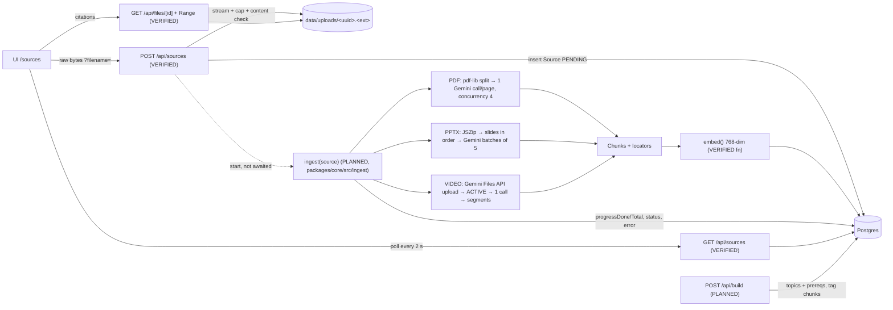

# Ingestion Specification

Updated: **2026-10-14** after Module 4. **Upload, validation, storage and file serving are implemented and tested. Parsing, chunking, embedding and indexing (Modules 5–8) are not.** Labels:

- **VERIFIED:** implemented and exercised by unit or e2e tests (or a recorded smoke run).
- **DEFINED:** present in the Prisma schema, Zod contract or config, but not exercised by any pipeline.
- **PLANNED:** described in `docs/ARCHITECTURE.md` §6.1–6.2 / `CLAUDE.md`, with no code.
- **UNRESOLVED:** see §9.

---

## 1. Accepted inputs (VERIFIED, Module 4)

| Type | Extension (decides the type) | Content check | Stored MIME | Limits |
|---|---|---|---|---|
| PDF | `.pdf` | `%PDF-` in the first 1 KB, parses with pdf-lib, not encrypted, ≥ 1 page | `application/pdf` | 500 MiB |
| PPTX | `.pptx` | ZIP signature, `ppt/presentation.xml`, ≥ 1 slide | `application/vnd.openxmlformats-officedocument.presentationml.presentation` | 500 MiB |
| VIDEO | `.mp4` | `ftyp` box, readable `moov/mvhd` duration | `video/mp4` | 500 MiB **and ≤ 20:00** |

- **The browser MIME type is ignored.** The extension picks the type and the content must match it, so a renamed `.docx`, a `.ppt` or a ZIP that isn't a deck are all rejected with a clear 400.
- **Not accepted:** `.ppt`, `.key`, PDF-exported decks (LibreOffice is cut), YouTube URLs (cut), non-MP4 containers.
- Scanned-only PDFs pass upload. Whether Gemini extracts them well is unverified (Module 5).

**Implementation:**
- `sourceTypeFromFilename()`, `ACCEPTED_EXTENSIONS`, `MAX_UPLOAD_BYTES` live in `@sc/schemas`, shared by client and server.
- `inspectMedia()` / `readMp4DurationSec()` live in `packages/core/src/media.ts`.
- MP4 duration is read **without ffmpeg** by walking ISO BMFF boxes. It handles `moov` before or after `mdat`, `mvhd` v0 and v1, and 64-bit box sizes, and is verified on synthetic MP4 structures. **It has not yet been run on a real lecture file;** run one through upload as soon as the dataset exists.

---

## 2. Upload contract (VERIFIED, Module 4; contract v1.1)

`POST /api/sources?filename=<url-encoded name>`, with **the raw file bytes as the body** (not multipart).

```
POST /api/sources?filename=NPTEL_OS_Lec12_Scheduling.mp4 HTTP/1.1
Content-Type: application/octet-stream
Content-Length: 187654321

…binary…
```

- Client: `api.uploadSource(file)` (`@sc/client`). It checks the extension and size before sending.
- Server (`uploadSource()` in `packages/core/src/sources.ts`):
  1. Requires the course.
  2. Rejects an oversize `Content-Length` before reading.
  3. **Streams** to `data/uploads/<uuid>.<ext>.part` with the 500 MiB cap.
  4. Runs the content check.
  5. Renames to the final path and inserts the `Source`. Any failure leaves no file and no row.
- Response (`UploadResponse`): `{ "id": "<uuid>", "status": "PENDING" }`. `PENDING` means stored and waiting for ingestion; Module 5 will start ingestion on upload and return `PROCESSING`.
- **Why raw bytes:** `request.formData()` buffers the whole upload in memory, and no Next body limit applies without a proxy. **Verified:** a 2 GiB chunked upload was rejected after **503 MiB** had been sent, which proves the body is streamed and cut off, not buffered.
- No extra metadata fields (title, course, language). `filename` comes from the query (base name only); `mimeType` and `sizeBytes` come from the server.

## 3. Pipeline overview



Steps (ARCHITECTURE §6.1, PLANNED):
1. **(VERIFIED, Module 4)** Save the original; create `Source { status: PENDING, pageCount | durationSec }`. **(PLANNED, Module 5)** Start ingestion: `status: PROCESSING`, `progressTotal` = pages / ⌈slides/5⌉ / 1.
2. Run the type-specific extraction (§4), producing chunks with exactly one locator each.
3. Embed every chunk (`embed(texts, "RETRIEVAL_DOCUMENT")`), then insert the `Chunk` rows.
4. Set `status = READY`. On any error, set `status = FAILED` and `error = <message>`.
5. Later, `POST /api/build` creates topics and sets `Chunk.topicId`.

**Re-ingestion (PLANNED):** delete the source's chunks (cascade) and recreate them.

**Startup recovery: UNRESOLVED.** A server restart during ingestion leaves `PROCESSING` rows that nothing will finish, because there is no worker (by design). Proposal: on boot, mark stale `PROCESSING` rows as `FAILED` with `error: "interrupted"`.

---

## 4. Per-type processing

### 4.1 PDF (PLANNED, Module 5)

| Step | Detail | Evidence |
|---|---|---|
| Split | `pdf-lib` copies each page into a 1-page PDF | `pdf-lib@1.17.1` installed in `@sc/core`; no code |
| Extract | One `generateJson` call per page on `LLM_MODEL_FAST` with an inline `application/pdf` part. Output `{ blocks: [{ kind: "text" \| "figure" \| "table", content }], conceptLabels: string[] }` | **VERIFIED on a synthetic 1-page PDF** (Module 1 smoke `pdf`: 3 blocks, the figure described with P1/24 values, 578 in / 318 out tokens, 9.2 s) |
| Chunk | text/table blocks → `Chunk(kind=TEXT)`; **each figure → its own `Chunk(kind=FIGURE)`** with the description as `content` and the caption as `title` | PLANNED |
| Locator | `page` = 1-based page index in the file | DEFINED (`Chunk.page`) |
| Concurrency | 4 pages at a time | PLANNED. **No limiter exists in `llm.ts`** |
| Progress | `progressTotal` = page count, `progressDone` += 1 per page | DEFINED (schema comment) |

### 4.2 PPTX (PLANNED, Module 6)

| Step | Detail | Evidence |
|---|---|---|
| Order | Slide order from `ppt/presentation.xml` `<p:sldIdLst>` plus `ppt/_rels/presentation.xml.rels` | PLANNED; `jszip@3.10.2` installed |
| Text | All `<a:t>` runs per slide | PLANNED |
| Images | Slide rels → `ppt/media/*` | PLANNED. ⚠ Decks often embed `.emf`/`.wmf`, which Gemini doesn't accept as image input. **Skip unsupported formats** (risk, see INTEGRATION_AUDIT) |
| Extract | Batches of **5 slides** (text + images) per `generateJson` call | **VERIFIED pattern** on 2 synthetic slides (Module 1 smoke `slides`: correct slide numbering, bar counts and colours; 2214 in / 137 out tokens) |
| Chunk | **One `Chunk(kind=SLIDE)` per slide**: `title` = slide title, `content` = slide text plus figure descriptions | PLANNED |
| Locator | `slide` = 1-based presentation order | DEFINED (`Chunk.slide`) |
| Progress | `progressTotal` = ⌈slides/5⌉ batches | DEFINED (schema comment) |

### 4.3 Video (PLANNED, Module 7)

| Step | Detail | Evidence |
|---|---|---|
| Upload | `uploadFile(path, "video/mp4")` → Gemini Files API, polled every 2 s until `ACTIVE` (5-min timeout) | Function exists in `packages/core/src/llm.ts`. **Never executed** (smoke `video` skipped: no sample mp4) |
| Remote handle | `Source.geminiFileName`, `geminiFileUri`, `geminiFileExpiresAt` (remote copies expire after 48 h; the original stays in `data/uploads`) | DEFINED (schema) |
| "Transcription" | **No dedicated ASR.** One multimodal `generateJson` call on `LLM_MODEL_STRONG` (currently `gemini-3.1-flash-lite`) returns `segments: [{ tStart, tEnd, transcript, onScreen, conceptLabels }]` | PLANNED. **Unverified** whether this model returns accurate timestamps for a 15–20 min lecture |
| Chunk | One `Chunk(kind=TRANSCRIPT)` per segment; `content = "<transcript>\n[On screen] <onScreen>"` (Q11, adopted) | PLANNED |
| Locator | `tStart`, `tEnd` in seconds (float). Clamp to `[0, durationSec]`, but **`durationSec` is never measured** | DEFINED / UNRESOLVED |
| Progress | `progressTotal = 1` | DEFINED (schema comment) |
| Cost risk | A 20-min video is roughly 300k+ input tokens at default media resolution (estimate from Gemini's documented per-second video token rate; **not measured**). It may exceed free-tier tokens-per-minute limits, which are also unverified (AI Studio → Rate limits) | UNVERIFIED |

---

## 5. Embeddings and retrieval

| Item | Detail | Status |
|---|---|---|
| Model | `EMBED_MODEL = gemini-embedding-001`, `outputDimensionality: 768` (`EMBED_DIM`) | **VERIFIED** (smoke `embed`: dim 768; the RR query ranked the RR doc first, 0.806 vs 0.483) |
| Task types | documents `RETRIEVAL_DOCUMENT`, queries `RETRIEVAL_QUERY` | VERIFIED (`embed()` in `llm.ts`) |
| Batching | 100 texts per request | implemented in `embed()`, only exercised with 3 texts |
| Embedded text | `title ? title + "\n" + content : content` (Q16, adopted) | PLANNED |
| Storage | `Chunk.embedding Float[]` → Postgres `DOUBLE PRECISION[]`; empty array until embedded | **VERIFIED** (`db:verify`: 768 values round-trip, max error 5.6e-17) |
| Index | **No vector index** (pgvector is cut). Cosine is computed in JS over all chunks of the course | PLANNED (`retrieve.ts` doesn't exist) |
| Query | Top 6 by cosine. `topScore` = best cosine. Refuse if `topScore < REFUSAL_TAU` (env, **placeholder 0.55, uncalibrated**) | PLANNED |
| Topics | `Topic.embedding` (name + description) tags each chunk to its nearest topic at build time | DEFINED (schema) / PLANNED |

---

## 6. What is stored where

| Data | Location | Status |
|---|---|---|
| Original files | Local disk `data/uploads/<sourceId>.<ext>` (gitignored). `Source.path` holds it **relative to the repo root**, resolved by `repoRoot()` (nearest `turbo.json`, or `REPO_ROOT`), so it works although `next dev` runs in `apps/web`. Paths outside `data/uploads` are refused | **VERIFIED** (core + e2e tests) |
| Video remote copy | Gemini Files API, 48 h | DEFINED |
| Source metadata (`type`, `filename`, `mimeType`, `sizeBytes`, `path`, `pageCount`/`durationSec`), status | Postgres `Source` | **VERIFIED** (upload); progress/errors written from Module 5 |
| Chunk text, locators, concept labels, embeddings, topic tag | Postgres `Chunk` | DEFINED |
| Topics, prerequisites, topic embeddings | Postgres `Topic` | DEFINED |
| Object storage / CDN | none (by design: single local process) | n/a |

---

## 7. Concrete data examples

**Source row right after upload (VERIFIED shape, Module 4):**
```json
{ "id": "3f8a2c1e-…", "courseId": "demo-course", "type": "PDF", "filename": "Galvin_Ch5_CPU_Scheduling.pdf",
  "mimeType": "application/pdf", "sizeBytes": 2483112, "path": "data/uploads/3f8a2c1e-….pdf",
  "status": "PENDING", "error": null, "progressDone": 0, "progressTotal": 0, "pageCount": 28,
  "durationSec": null, "geminiFileName": null, "geminiFileUri": null, "geminiFileExpiresAt": null }
```
**What the UI sees during ingestion (DEFINED: `SourceView`; values PLANNED for Module 5):**
```json
{ "id": "3f8a2c1e-…", "type": "PDF", "filename": "Galvin_Ch5_CPU_Scheduling.pdf", "status": "PROCESSING",
  "error": null, "progressDone": 12, "progressTotal": 28, "chunkCount": 0, "createdAt": "2026-10-14T09:00:00.000Z" }
```
**Processed chunk (DEFINED columns: `Chunk`; values PLANNED):**
```json
{ "id": "c-pdf-7-1", "sourceId": "src-pdf", "kind": "FIGURE", "seq": 14, "title": "Figure 5.4 Gantt chart for FCFS",
  "content": "Gantt chart: P1 runs 0–24 ms, P2 runs 24–27 ms, P3 runs 27–30 ms. Waiting times 0, 24, 27 ms; average 17 ms.",
  "page": 7, "slide": null, "tStart": null, "tEnd": null,
  "conceptLabels": ["FCFS", "Gantt chart", "waiting time"], "embedding": [0.0123, -0.0456, "… 768 numbers …"], "topicId": "t-fcfs" }
```
**Citation referencing that chunk (DEFINED: `Citation`; `[mock]` `citations.fcfsGantt`):**
```json
{ "sourceType": "PDF", "sourceId": "src-pdf", "filename": "Galvin_Ch5_CPU_Scheduling.pdf", "chunkId": "c-pdf-7-1",
  "kind": "FIGURE", "title": "Figure 5.4 Gantt chart for FCFS", "page": 7,
  "excerpt": "Gantt chart: P1 runs 0–24 ms, P2 runs 24–27 ms, P3 runs 27–30 ms. Waiting times 0, 24, 27 ms; average 17 ms." }
```
**Chunk → Citation mapping (PLANNED; the rule follows from the two schemas):**

| Citation field | From |
|---|---|
| `chunkId`, `kind`, `title` | `Chunk.id`, `Chunk.kind`, `Chunk.title` |
| `excerpt` | `Chunk.content`, truncated to ≤ 600 chars (Q10) |
| `sourceId`, `filename` | `Chunk.sourceId`, `Source.filename` |
| `sourceType` | `Source.type` |
| `page` / `slide` / `tStart`, `tEnd` | the one non-null locator on the chunk |

The URL is built client-side with `citationHref()`: `/api/files/{sourceId}#page=N` · `#t=S` · plain URL for PPTX.

---

## 8. What the frontend must show during ingestion

| State | UI (from TEAMMATE_BRIEF Task 4 + `SourceView`) |
|---|---|
| `PENDING` / `PROCESSING` | status badge + progress bar `progressDone / progressTotal` (if `progressTotal = 0`, show indeterminate); keep polling every 2 s. Until Module 5, uploads stay `PENDING` |
| `READY` | `chunkCount` |
| `FAILED` | `error` text + **Delete** (`DELETE /api/sources/[id]`, live; 409 while PROCESSING). Retry endpoint proposed for Module 5 |
| All READY | enable "Build course" (`POST /api/build`) |
| Expected durations | PDF: about ⌈pages/4⌉ × ~9 s per call (≈ 60 s for 28 pages, before any rate limiting). Video: one long call plus upload (unmeasured) |

---

## 9. Ingestion decisions

| # | Question | Status |
|---|---|---|
| Q2 | Upload cap; video-length enforcement | **Resolved (Module 4):** 500 MiB streamed cap; MP4 duration parsed server-side, > 20:00 rejected |
| Q13 | Error code for bad uploads | **Resolved:** `bad_request` 400 with a user-readable message |
| Q11 | Video chunk `content` composition | Adopted: `transcript + "\n[On screen] " + onScreen` (implement in Module 7) |
| Q16 | Embedded text | Adopted: `title + "\n" + content` (Module 8) |
| Q17 | Restart recovery for `PROCESSING` sources | Adopted: mark stale PROCESSING as FAILED ("interrupted") on boot (Module 5) |
| Q18 | Unsupported PPTX media (`.emf`/`.wmf`/`.svg`) | Adopted: skip and note `[figure omitted: unsupported format]` (Module 6) |
| Q19 | Gemini rate limiting | Open: read RPM/TPM in AI Studio → Rate limits; add a limiter to `llm.ts` before Module 5 |
