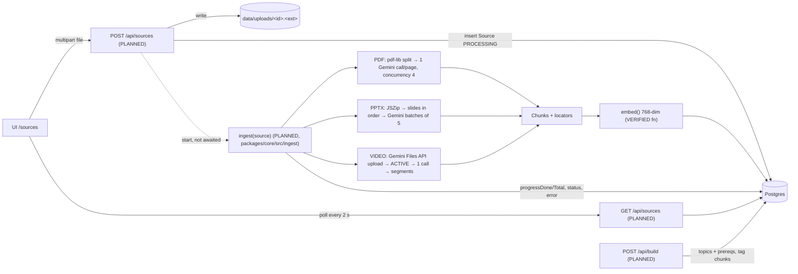

# Ingestion Specification

Audited: **2026-10-14**. **No ingestion code exists yet.** There is no `packages/core/src/ingest/`, no upload route and no file route. This document separates:

- **VERIFIED:** observed in code or a test run during this audit or a recorded module test.
- **DEFINED:** present in the Prisma schema, Zod contract or config, but not exercised by any pipeline.
- **PLANNED:** described in `docs/ARCHITECTURE.md` §6.1–6.2 / `CLAUDE.md`, with no code.
- **UNRESOLVED:** neither the repo nor the docs decide it; see the questions in §9.

---

## 1. Accepted inputs

| Type | MIME (DEFINED: `ACCEPTED_UPLOADS`, `packages/schemas/src/course.ts`) | Extension | Limits | Not accepted |
|---|---|---|---|---|
| PDF | `application/pdf` | `.pdf` | ❓ size: none defined | scanned-only PDFs are not specially handled (Gemini reads page images, so they likely work but are unverified) |
| PPTX | `application/vnd.openxmlformats-officedocument.presentationml.presentation` | `.pptx` | ❓ size: none defined | `.ppt`, `.key`, PDF-exported decks (LibreOffice is cut) |
| VIDEO | `video/mp4` | `.mp4` | **≤ 20 min** (`MAX_VIDEO_MINUTES = 20`, DEFINED); ❓ size: none defined | YouTube URLs (cut), other containers |

**Validation rules**
- PLANNED (minimum):
  - The multipart field `file` is present and non-empty.
  - The type is one of the three above.
- UNRESOLVED / recommended:
  - Browsers on Windows can report `File.type` as `""` for `.pptx`. Determine the type from the **extension plus magic bytes** (`%PDF`, `PK\x03\x04` for pptx/zip, `ftyp` at offset 4 for mp4), not just the client MIME.
  - Enforce the 20-minute video limit. **Nothing measures duration today**, and `ffmpeg` isn't installed on the dev machine (verified in Module 1).
  - Pick a byte cap. Route handlers buffer `request.formData()` in memory, and no Next body limit applies without a proxy (verified: `proxyClientMaxBodySize` only applies when a proxy is used, and none exists).

---

## 2. Upload contract (PLANNED, Module 4)

`POST /api/sources`, `multipart/form-data`, single field **`file`** (DEFINED in `packages/schemas/src/endpoints.ts`).

```
POST /api/sources HTTP/1.1
Content-Type: multipart/form-data; boundary=----X

------X
Content-Disposition: form-data; name="file"; filename="NPTEL_OS_Lec12_Scheduling.mp4"
Content-Type: video/mp4

…binary…
------X--
```

Response (DEFINED: `UploadResponse`): `{ "id": "<source id>", "status": "PROCESSING" }`. Then the UI polls `GET /api/sources` (`SourceView[]`).

No extra metadata fields (title, course, language) are part of the contract. `filename` comes from the multipart part; `mimeType` and `sizeBytes` come from the server.

---

## 3. Pipeline overview



Steps (ARCHITECTURE §6.1, PLANNED):
1. Save the original. Create `Source { status: PROCESSING, progressDone: 0, progressTotal: N }`.
2. Run the type-specific extraction (§4), producing chunks with exactly one locator each.
3. Embed every chunk (`embed(texts, "RETRIEVAL_DOCUMENT")`), then insert the `Chunk` rows.
4. Set `status = READY`. On any error, set `status = FAILED` and `error = <message>`.
5. Later, `POST /api/build` creates topics and sets `Chunk.topicId`.

**Re-ingestion (PLANNED):** delete the source's chunks (cascade) and recreate them.

**Startup recovery: UNRESOLVED.** A server restart during ingestion leaves `PROCESSING` rows that nothing will finish, because there is no worker (by design). Proposal: on boot, mark stale `PROCESSING` rows as `FAILED` with `error: "interrupted"`.

---

## 4. Per-type processing

### 4.1 PDF (PLANNED, Module 5)

| Step | Detail | Evidence |
|---|---|---|
| Split | `pdf-lib` copies each page into a 1-page PDF | `pdf-lib@1.17.1` installed in `@sc/core`; no code |
| Extract | One `generateJson` call per page on `LLM_MODEL_FAST` with an inline `application/pdf` part. Output `{ blocks: [{ kind: "text" \| "figure" \| "table", content }], conceptLabels: string[] }` | **VERIFIED on a synthetic 1-page PDF** (Module 1 smoke `pdf`: 3 blocks, the figure described with P1/24 values, 578 in / 318 out tokens, 9.2 s) |
| Chunk | text/table blocks → `Chunk(kind=TEXT)`; **each figure → its own `Chunk(kind=FIGURE)`** with the description as `content` and the caption as `title` | PLANNED |
| Locator | `page` = 1-based page index in the file | DEFINED (`Chunk.page`) |
| Concurrency | 4 pages at a time | PLANNED. **No limiter exists in `llm.ts`** |
| Progress | `progressTotal` = page count, `progressDone` += 1 per page | DEFINED (schema comment) |

### 4.2 PPTX (PLANNED, Module 6)

| Step | Detail | Evidence |
|---|---|---|
| Order | Slide order from `ppt/presentation.xml` `<p:sldIdLst>` plus `ppt/_rels/presentation.xml.rels` | PLANNED; `jszip@3.10.2` installed |
| Text | All `<a:t>` runs per slide | PLANNED |
| Images | Slide rels → `ppt/media/*` | PLANNED. ⚠ Decks often embed `.emf`/`.wmf`, which Gemini doesn't accept as image input. **Skip unsupported formats** (risk, see INTEGRATION_AUDIT) |
| Extract | Batches of **5 slides** (text + images) per `generateJson` call | **VERIFIED pattern** on 2 synthetic slides (Module 1 smoke `slides`: correct slide numbering, bar counts and colours; 2214 in / 137 out tokens) |
| Chunk | **One `Chunk(kind=SLIDE)` per slide**: `title` = slide title, `content` = slide text plus figure descriptions | PLANNED |
| Locator | `slide` = 1-based presentation order | DEFINED (`Chunk.slide`) |
| Progress | `progressTotal` = ⌈slides/5⌉ batches | DEFINED (schema comment) |

### 4.3 Video (PLANNED, Module 7)

| Step | Detail | Evidence |
|---|---|---|
| Upload | `uploadFile(path, "video/mp4")` → Gemini Files API, polled every 2 s until `ACTIVE` (5-min timeout) | Function exists in `packages/core/src/llm.ts`. **Never executed** (smoke `video` skipped: no sample mp4) |
| Remote handle | `Source.geminiFileName`, `geminiFileUri`, `geminiFileExpiresAt` (remote copies expire after 48 h; the original stays in `data/uploads`) | DEFINED (schema) |
| "Transcription" | **No dedicated ASR.** One multimodal `generateJson` call on `LLM_MODEL_STRONG` (currently `gemini-3.1-flash-lite`) returns `segments: [{ tStart, tEnd, transcript, onScreen, conceptLabels }]` | PLANNED. **Unverified** whether this model returns accurate timestamps for a 15–20 min lecture |
| Chunk | One `Chunk(kind=TRANSCRIPT)` per segment. ❓ Q11: how `transcript` and `onScreen` combine into `content` (proposed: `"<transcript>\n[On screen] <onScreen>"`) | UNRESOLVED |
| Locator | `tStart`, `tEnd` in seconds (float). Clamp to `[0, durationSec]`, but **`durationSec` is never measured** | DEFINED / UNRESOLVED |
| Progress | `progressTotal = 1` | DEFINED (schema comment) |
| Cost risk | A 20-min video is roughly 300k+ input tokens at default media resolution (estimate from Gemini's documented per-second video token rate; **not measured**). It may exceed free-tier tokens-per-minute limits, which are also unverified (AI Studio → Rate limits) | UNVERIFIED |

---

## 5. Embeddings and retrieval

| Item | Detail | Status |
|---|---|---|
| Model | `EMBED_MODEL = gemini-embedding-001`, `outputDimensionality: 768` (`EMBED_DIM`) | **VERIFIED** (smoke `embed`: dim 768; the RR query ranked the RR doc first, 0.806 vs 0.483) |
| Task types | documents `RETRIEVAL_DOCUMENT`, queries `RETRIEVAL_QUERY` | VERIFIED (`embed()` in `llm.ts`) |
| Batching | 100 texts per request | implemented in `embed()`, only exercised with 3 texts |
| Embedded text | ❓ `content` only, or `title + content`? Proposed: `title ? title + "\n" + content : content` | UNRESOLVED |
| Storage | `Chunk.embedding Float[]` → Postgres `DOUBLE PRECISION[]`; empty array until embedded | **VERIFIED** (`db:verify`: 768 values round-trip, max error 5.6e-17) |
| Index | **No vector index** (pgvector is cut). Cosine is computed in JS over all chunks of the course | PLANNED (`retrieve.ts` doesn't exist) |
| Query | Top 6 by cosine. `topScore` = best cosine. Refuse if `topScore < REFUSAL_TAU` (env, **placeholder 0.55, uncalibrated**) | PLANNED |
| Topics | `Topic.embedding` (name + description) tags each chunk to its nearest topic at build time | DEFINED (schema) / PLANNED |

---

## 6. What is stored where

| Data | Location | Status |
|---|---|---|
| Original files | Local disk `data/uploads/<sourceId>.<ext>` (gitignored). `Source.path` holds it **relative to the repo root** | DEFINED (schema comment, `.gitignore`) |
| Video remote copy | Gemini Files API, 48 h | DEFINED |
| Source metadata, status, progress, errors | Postgres `Source` | DEFINED |
| Chunk text, locators, concept labels, embeddings, topic tag | Postgres `Chunk` | DEFINED |
| Topics, prerequisites, topic embeddings | Postgres `Topic` | DEFINED |
| Object storage / CDN | none (by design: single local process) | n/a |

---

## 7. Concrete data examples

**Source row after upload (PLANNED values, DEFINED columns: `Source` in `schema.prisma`):**
```json
{ "id": "cm2abc…", "courseId": "demo-course", "type": "PDF", "filename": "Galvin_Ch5_CPU_Scheduling.pdf",
  "mimeType": "application/pdf", "sizeBytes": 2483112, "path": "data/uploads/cm2abc….pdf",
  "status": "PROCESSING", "error": null, "progressDone": 12, "progressTotal": 28, "pageCount": 28,
  "durationSec": null, "geminiFileName": null, "geminiFileUri": null, "geminiFileExpiresAt": null }
```
**What the UI sees (DEFINED: `SourceView`, `[mock]`-shaped):**
```json
{ "id": "cm2abc…", "type": "PDF", "filename": "Galvin_Ch5_CPU_Scheduling.pdf", "status": "PROCESSING",
  "error": null, "progressDone": 12, "progressTotal": 28, "chunkCount": 0, "createdAt": "2026-10-14T09:00:00.000Z" }
```
**Processed chunk (DEFINED columns: `Chunk`; values PLANNED):**
```json
{ "id": "c-pdf-7-1", "sourceId": "src-pdf", "kind": "FIGURE", "seq": 14, "title": "Figure 5.4 Gantt chart for FCFS",
  "content": "Gantt chart: P1 runs 0–24 ms, P2 runs 24–27 ms, P3 runs 27–30 ms. Waiting times 0, 24, 27 ms; average 17 ms.",
  "page": 7, "slide": null, "tStart": null, "tEnd": null,
  "conceptLabels": ["FCFS", "Gantt chart", "waiting time"], "embedding": [0.0123, -0.0456, "… 768 numbers …"], "topicId": "t-fcfs" }
```
**Citation referencing that chunk (DEFINED: `Citation`; `[mock]` `citations.fcfsGantt`):**
```json
{ "sourceType": "PDF", "sourceId": "src-pdf", "filename": "Galvin_Ch5_CPU_Scheduling.pdf", "chunkId": "c-pdf-7-1",
  "kind": "FIGURE", "title": "Figure 5.4 Gantt chart for FCFS", "page": 7,
  "excerpt": "Gantt chart: P1 runs 0–24 ms, P2 runs 24–27 ms, P3 runs 27–30 ms. Waiting times 0, 24, 27 ms; average 17 ms." }
```
**Chunk → Citation mapping (PLANNED; the rule follows from the two schemas):**

| Citation field | From |
|---|---|
| `chunkId`, `kind`, `title` | `Chunk.id`, `Chunk.kind`, `Chunk.title` |
| `excerpt` | `Chunk.content` (❓ Q10 truncation) |
| `sourceId`, `filename` | `Chunk.sourceId`, `Source.filename` |
| `sourceType` | `Source.type` |
| `page` / `slide` / `tStart`, `tEnd` | the one non-null locator on the chunk |

The URL is built client-side with `citationHref()`: `/api/files/{sourceId}#page=N` · `#t=S` · plain URL for PPTX.

---

## 8. What the frontend must show during ingestion

| State | UI (from TEAMMATE_BRIEF Task 4 + `SourceView`) |
|---|---|
| `PENDING` / `PROCESSING` | status badge + progress bar `progressDone / progressTotal` (if `progressTotal = 0`, show indeterminate); keep polling every 2 s |
| `READY` | `chunkCount` |
| `FAILED` | `error` text. **There's no retry or delete endpoint** (INTEGRATION_AUDIT I-08) |
| All READY | enable "Build course" (`POST /api/build`) |
| Expected durations | PDF: about ⌈pages/4⌉ × ~9 s per call (≈ 60 s for 28 pages, before any rate limiting). Video: one long call plus upload (unmeasured) |

---

## 9. Unresolved ingestion decisions

| # | Question |
|---|---|
| Q2 | Max upload size, and how the 20-min video limit is measured and enforced |
| Q11 | Video chunk `content` composition (`transcript` + `onScreen`) |
| Q16 | Embedded text: `content` or `title + content` |
| Q17 | Server-restart recovery for `PROCESSING` sources |
| Q18 | Unsupported PPTX media (`.emf`/`.wmf`/`.svg`): skip silently, or note in the slide content? |
| Q19 | Rate limiting: a token bucket in `llm.ts` sized to the AI Studio free-tier RPM/TPM (values not yet read from AI Studio) |
