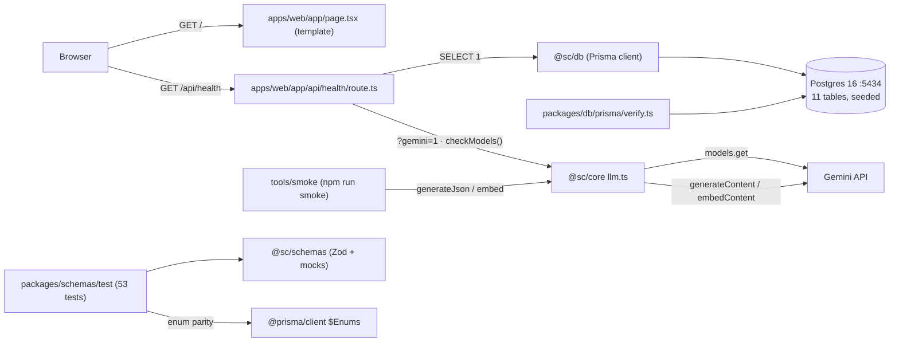
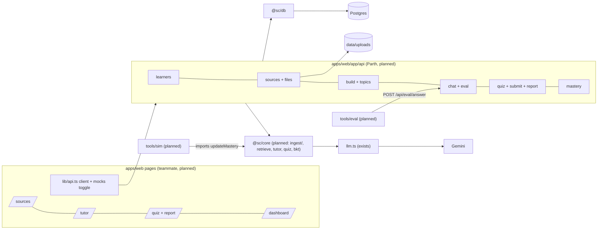
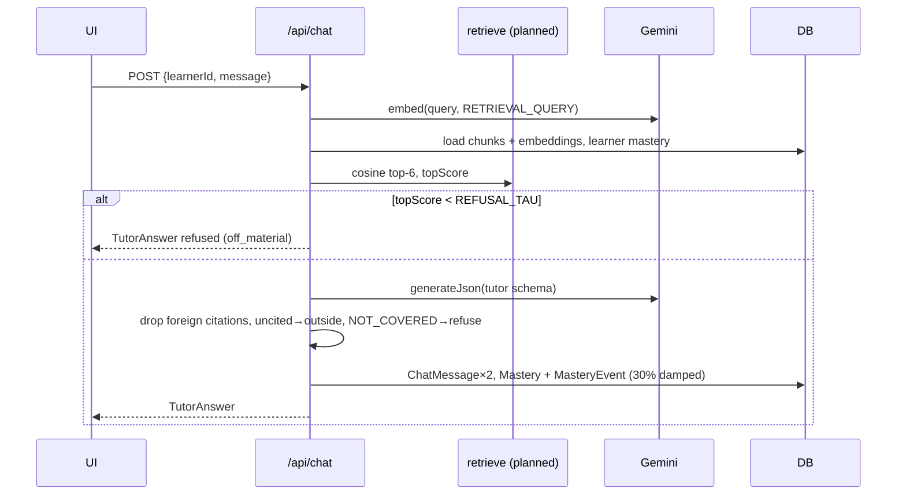
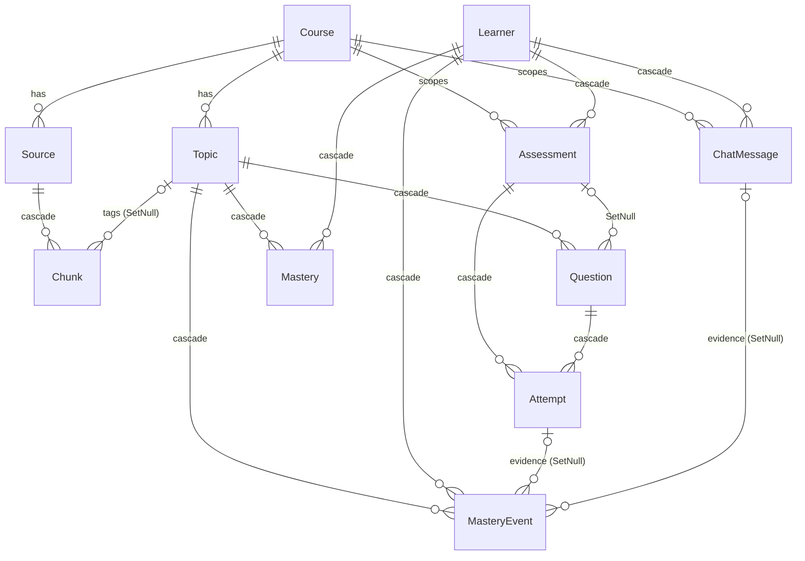

# Integration Audit

Audited: **2026-10-14**, repository at commit `2d5d93a` (Modules 0–3) plus uncommitted edits to `docs/ARCHITECTURE.md` and `docs/PROGRESS.md`.
Scope: every file under `apps/`, `packages/`, `tools/`, `docs/`, plus root config. `.env` was **not read** (only `.env.example`).
Companion docs: [API_SPEC.md](API_SPEC.md) (endpoint contracts), [INGESTION_SPEC.md](INGESTION_SPEC.md) (pipeline).

---

## 1. Evidence collected

| Check | Command / method | Result |
|---|---|---|
| Files in repo | `find` (excluding node_modules, .next, .env) | 62 files. Route files: **only** `apps/web/app/api/health/route.ts`. Pages: create-next-app template `page.tsx` + `layout.tsx` |
| Endpoint probe | `curl` every documented method + path on `localhost:3000` | `GET /api/health` → 200 JSON. **15 others → 404 `text/html`**. `POST /api/health` → **405, empty body** |
| Client failure mode | node `fetch('/api/sources')` then `res.json()` | **throws `SyntaxError`** (status 404) |
| Contract tests | `npm run test -- --force` | **53/53 pass** |
| DB behaviour | `npm run db:verify` | **12/12 PASS** |
| Migrations | `npm run db:status` | "Database schema is up to date!" (1 migration: `20261013184923_init`) |
| DB contents | `psql` counts | Course 1, Learner 1, Source/Chunk/Topic/Question/Mastery 0 |
| Health + Gemini | `GET /api/health?gemini=1` | 200; DB ok; all 6 env keys present; 3 models reachable (metadata only) |
| Gemini calls | Module 1 smoke (2026-10-14; not re-run, it costs tokens) | json / pdf / slides / embed pass; **video never run** |
| Typecheck / lint | `npm run typecheck`, `npm run lint` | 5/5 packages clean; lint clean |
| Usage of `@sc/schemas` in app code | grep | **none** (only `transpilePackages` in `next.config.ts`) |
| Exports of `@sc/core` | grep | `generateJson`, `embed`, `uploadFile`, `deleteFile`, `checkModels`, `modelFor`, `LlmError`, `EMBED_DIM` (+ types). No ingest/retrieve/tutor/quiz/bkt |
| Next upload body limit | Next docs `proxyClientMaxBodySize.md` | Applies only when a proxy exists. **No proxy, so no limit** |

---

## 2. Feature status

Legend: ✅ Implemented and verified · 🟨 Partially implemented · 📄 Defined in schemas/docs but not implemented · ❌ Missing · ⛔ Blocked by a dependency

| Feature | Status | Evidence |
|---|---|---|
| Monorepo, scripts, env loading | ✅ | `turbo.json`, root `package.json` (16 scripts), `apps/web/scripts/next.mjs`; dev server serves `/api/health` |
| Postgres + Prisma schema (11 models, 9 enums) | ✅ | `packages/db/prisma/schema.prisma`, migration `init`, `db:verify` 12/12 |
| Seed (`demo-course`, `demo-learner`) | ✅ | `packages/db/prisma/seed.ts`; rows present |
| Gemini structured JSON (`generateJson`) | ✅ | `packages/core/src/llm.ts`; smoke json/pdf/slides pass |
| Embeddings (`embed`, 768-dim) | ✅ | smoke `embed` pass |
| Gemini Files API (`uploadFile`, `deleteFile`) | 🟨 | code exists, **never executed** (smoke video skipped) |
| Health endpoint (+ `?gemini=1`) | ✅ | probe 200; DB-down 503 verified in Module 0 |
| Shared contract `@sc/schemas` | ✅ (tests) / 🟨 (adoption) | 53 tests pass, but **no route or page imports it yet** |
| Mocks for all 14 registry endpoints | ✅ | test "every endpoint has a mock" + per-endpoint validation |
| Standard error body (`ApiErrorBody`) | 📄 | defined in `common.ts`; emitted by no route |
| Learners API | 📄 | `endpoints.ts` (module 4); 404 |
| Upload + source list + progress | 📄 | `endpoints.ts`; DB columns exist; 404 |
| File serving with Range (`/api/files/[id]`) | 📄 | comment in `endpoints.ts`; 404 |
| PDF ingestion | 📄 | ARCHITECTURE §6.1; only the Gemini extraction capability is verified (1 synthetic page) |
| PPTX ingestion | 📄 / ⛔ | no code; real test blocked by the missing dataset |
| Video ingestion / transcription | 📄 / ⛔ | no code; Files API path unverified; dataset missing |
| Concurrency / rate limiting for Gemini | ❌ | `llm.ts` has a single retry (1 s / 5 s backoff), no limiter, no timeout |
| Retrieval (cosine top-6, τ refusal) | ❌ | no `retrieve.ts`; `REFUSAL_TAU` = placeholder 0.55 |
| Course build (topics, prereqs, tagging) | 📄 | `BuildResponse`/`TopicView`; DB `Topic`; 404 |
| Tutor + grounding guards | 📄 | rules encoded and tested in `TutorAnswer`/`TutorBlock`; no tutor code |
| Chat history | 📄 | `ChatMessageView`; DB `ChatMessage` |
| BKT / `updateMastery` | ❌ | not in code; signature promised in TEAMMATE_BRIEF Task 10 |
| Quiz generation + blind verify + no-repeat | 📄 | contract + DB (`stemHash`, `verified`, `verifierAnswer`) ready; no code |
| Grading + report + misconceptions | 📄 | `QuizReport`; DB `Attempt`; no code |
| Mastery view / history | 📄 / ⛔ | `MasteryView`; needs BKT |
| Eval endpoint | 📄 | `EvalAnswerResponse`; 404 |
| Eval test set + scripts (RAGAS, citation score) | ❌ / ⛔ | `TestSet` schema + `testSetGaps` only; teammate Tasks 8–9; needs dataset |
| Student simulator | ❌ / ⛔ | teammate Task 10; real estimator needs BKT |
| Frontend pages, app shell, learner picker | ❌ | template only |
| Frontend API client | ❌ | snippet in `docs/TEAMMATE_BRIEF.md` §4 only, **with a defect (I-01)** |
| Citation panel (PDF / slide / video) | ❌ / ⛔ | teammate Task 3; needs `/api/files` for real files |
| Course map, Hindi/Hinglish (optional) | ❌ | P1, after the full loop works |

**Bottom line:** the foundation (tooling, DB, Gemini access, contract, mocks) is real and tested. **No user-facing workflow works end to end yet.** Every Track D feature except health is either defined only or missing.

---

## 3. Verified architecture (what exists today)

## 4. Proposed architecture (NOT implemented; ARCHITECTURE.md §2, §6)

### 4.1 Planned request flows (PROPOSED, per ARCHITECTURE §6)

Upload → ingestion flow: see [INGESTION_SPEC.md §3](INGESTION_SPEC.md).
Quiz flow:
1. `POST /api/quiz` → `Assessment` + generate call + verify call → `Question` rows → `Quiz`.
2. `POST /api/quiz/[id]/submit` → grade (code, plus an LLM call for SHORT) → `Attempt` + BKT → `Mastery`/`MasteryEvent` → `Assessment.report` → `QuizReport`.

---

## 5. Database relationships (verified schema; no runtime code uses it yet)

All primary keys are `String @id @default(cuid())`. Unique constraints: `Mastery(learnerId, topicId)`, `Attempt(assessmentId, questionId)`. Indexes are in `migration.sql` (12). Full columns are in `schema.prisma`; summarised in ARCHITECTURE §5.

| Model | Purpose | Written by (planned endpoint) | Read by (planned endpoint) |
|---|---|---|---|
| Course | single course scope | seed | all (default `demo-course`) |
| Source | upload, status, progress, Gemini file handle | POST /api/sources, ingestion | GET /api/sources, /api/files/[id] |
| Chunk | content + exactly one locator + embedding + topic | ingestion, POST /api/build (topicId) | chat, eval, build, quiz, mastery (weak-topic citations) |
| Topic | topics, prereqIds (not FK-enforced), embedding | POST /api/build | /api/topics, quiz, mastery, chat |
| Learner | picker identity (no auth) | POST /api/learners, seed | GET /api/learners, all learner-scoped routes |
| Mastery | BKT p, n per learner×topic | chat, submit | chat, quiz create, mastery |
| MasteryEvent | history with evidence link | chat, submit | mastery (history), report |
| Assessment | quiz session, status, report JSON | POST /api/quiz, submit | GET quiz, report, mastery (needsDiagnostic) |
| Question | generated question, answer, verification, stemHash | POST /api/quiz | GET quiz, submit, no-repeat lookup |
| Attempt | graded answer, feedback, misconception | submit | report |
| ChatMessage | conversation + snapshotted citations, topScore | POST /api/chat | GET /api/chat |

**Gaps vs. promised features:**
- **No BKT parameter storage.** Parameters are constants (prior 0.3, learn 0.15, slip 0.1, guess per type); `Mastery.p` defaults to 0.3. Fine.
- **No per-course learner scoping.** Fine for a single course.
- **No source content hash**, so re-uploading the same file duplicates chunks (low).
- **Rebuilding topics cascades away `Mastery`, `MasteryEvent` and `Question`** (I-16).

The schema supports every feature promised in ARCHITECTURE. No missing column was found for citations (page/slide/tStart/tEnd + filename via Source).

---

## 6. Frontend ↔ backend compatibility

| Workflow (teammate task) | Contract | Backend today | Needed before real integration |
|---|---|---|---|
| Learner picker (T2) | `GET/POST /api/learners` → `Learner` | 404 | Module 4; Q15 |
| Upload + progress (T4) | multipart `file` → `UploadResponse`; poll `SourceView[]` | 404 | Module 4 (upload, list), 5–7 (progress); I-09, I-10, I-14; Q2, Q13 |
| Failed source handling (T4) | `status: FAILED`, `error` | 404 | **No retry/delete endpoint** (I-08) |
| Build course + topics (T4) | `BuildResponse`, `TopicView[]` | 404 | Module 9; Q9 |
| Citation panel: PDF (T3) | `citationHref` → `/api/files/{id}#page=N` | 404 | Module 4 file route (inline PDF); browser `#page` support unverified |
| Citation panel: video (T3) | `/api/files/{id}#t=S` + Range | 404 | Module 4 Range support; Module 7 real timestamps |
| Citation panel: slide card (T3) | `title` + `excerpt` + `slide` | n/a (mock) | Module 6 |
| Tutor chat (T5) | `ChatRequest` → `TutorAnswer` (+ refusal) | 404 | Modules 8, 10, 11; long pending state (I-21) |
| Chat history (T5) | `GET /api/chat?learnerId=` | 404 | Module 10; path builder (I-03) |
| Quiz start / take (T6) | `CreateQuizRequest` → `Quiz` | 404 | Module 12; ~20 s+ pending state |
| Quiz submit + report (T6) | `SubmitRequest` → `QuizReport` | 404 | Module 13; **I-06 (no option text in report)** |
| Dashboard (T7) | `MasteryView` | 404 | Modules 11, 14; Q7, Q8 |
| Eval scripts (T9) | `POST /api/eval/answer` → `EvalAnswerResponse`; `TestSet` | 404 | Module 10; dataset; test set |
| Simulator (T10) | `updateMastery(p, correct, type, weight?)` | missing | Module 11 |

**`NEXT_PUBLIC_USE_MOCKS`:**
- **Where it appears:** only in `.env.example` (`"0"`) and the brief's snippet. No code reads it yet.
- **How it would load:** `apps/web/scripts/next.mjs` loads the root `.env` into `process.env` before Next starts, so Next can inline `NEXT_PUBLIC_*` into client code. That should work, but it's **unverified** because no client code exists.
- **Changing it needs a dev-server restart.** It's all-or-nothing (I-02).

**Multipart:** the contract says field `file`. The client must not set `Content-Type` manually (the browser adds the boundary). This is documented in API_SPEC E4.

**Polling / loading / errors:** specified only in TEAMMATE_BRIEF (2 s polling, loading and error states in the definition of done). Nothing is implemented to check.

---

## 7. Issues and risks

Severity: **H** = blocks integration or a judged feature · **M** = causes rework or confusing failures · **L** = cosmetic or low impact.

| ID | Issue | Evidence | Impact | Sev | Recommended resolution |
|---|---|---|---|---|---|
| I-01 | Brief's `api()` calls `res.json()` **before** checking `res.ok` | TEAMMATE_BRIEF §4; verified: 404 returns HTML, `res.json()` throws `SyntaxError`; 405 has an empty body | With mocks off, any not-yet-built route crashes the page with a parse error instead of a typed `ApiError` | **H** | Check `res.ok` first; parse JSON only if `content-type` includes `application/json`; otherwise throw `ApiError("internal", \`HTTP ${status}\`)`. Update the brief before the teammate copies it |
| I-02 | Mock switch is global (`NEXT_PUBLIC_USE_MOCKS`) | brief §4/§6 | Backend lands per module; flipping the flag breaks every page whose endpoint isn't built yet | **H** | Per-endpoint switch, e.g. `NEXT_PUBLIC_LIVE_ENDPOINTS="listSources,uploadSource,…"` checked in `api()`, or mock-on-404 fallback in dev only |
| I-03 | Registry paths are templates (`/api/quiz/[id]`, `/api/chat?learnerId=`); query params have no schema | `endpoints.ts` | Calling `api(name)` without `opts.path` hits a literal `[id]` or an empty `learnerId`; each page builds URLs ad hoc | M | Add typed path builders to `@sc/schemas` (e.g. `paths.getQuiz(id)`, `paths.mastery(learnerId)`) and a `query` schema per GET endpoint |
| I-04 | `/api/health` and `/api/files/[id]` are not in the registry; health doesn't use `ApiErrorBody` | `endpoints.ts`, `health/route.ts` | Contract incomplete; UI can't type health | L | Add `health` (response schema) and document `files` as non-JSON. Health keeping its own shape is acceptable |
| I-05 | Success status codes unspecified | schemas define only error codes | Client/server mismatch if someone checks `=== 201` | L | Q1: 200 everywhere; client uses `res.ok` |
| I-06 | `AttemptResult` has no MCQ `options` / learner answer text | `quiz.ts`; mock shows only `{type:"MCQ", index:1}` | Report page must also call `GET /api/quiz/[id]` and join by `questionId` to show "Your answer: 17 ms" | M | Add `options: string[] \| null` to `AttemptResult` (additive; update mock) **before** the teammate builds the report page (T6) |
| I-07 | Mock mastery history inconsistent with `n` and with per-answer BKT | `mocks.ts`: `t-rr` has `n: 3` but 2 history events; 2 RR quiz answers produce 1 event; `t-proc` `n: 3` with 0 events | Charts built on mocks may assume per-topic events | L | Q8: one event per attempt; regenerate mock history to match `n` |
| I-08 | No way to retry or delete a FAILED source, and no recovery for sources stuck in PROCESSING after a restart | API inventory; no worker by design | A failed upload during the demo can't be fixed from the UI; restart leaves zombie PROCESSING rows | M | Add `DELETE /api/sources/[id]` (and optionally `POST …/retry`); on boot, mark stale PROCESSING rows as FAILED ("interrupted") |
| I-09 | `Source.path` is repo-root-relative, but `next dev` runs with cwd `apps/web` | `schema.prisma` comment; `@sc/web` scripts run in `apps/web` | File writes/reads would land in `apps/web/data/uploads` or 404 | **H** (Module 4) | One `UPLOAD_DIR` resolved from the repo root in `@sc/core` (or env), used by upload, ingestion and the file route |
| I-10 | Uploads buffered fully in memory; no size cap | Next docs: no body limit without a proxy | A large mp4 (hundreds of MB) can exhaust memory or stall the dev server | **H** | Q2: set a byte cap and stream to disk (`request.body` → file stream) instead of `formData()` for large files |
| I-11 | Video path unverified end to end | smoke `video` skipped; `uploadFile` never run; flash-lite timestamp quality unknown | The judged requirement "citations open exact timestamp" may fail late | **H** | Run `npm run smoke -- video` with a short mp4 **before** Module 7; consider `LLM_MODEL_STRONG` = a stronger model for video if timestamps are poor |
| I-12 | No rate limiting, concurrency control or timeouts in `llm.ts` | `llm.ts` (1 retry, 1 s/5 s backoff) | Free-tier RPM/TPM (not yet read from AI Studio) can be exceeded by 28-page PDF ingestion at concurrency 4, producing 429s and FAILED sources | **H** | Add a limiter (max concurrent + requests per minute from env), retry 429s with longer backoff, and a per-call timeout. Read the real limits in AI Studio → Rate limits |
| I-13 | 20-min video limit can't be enforced | `MAX_VIDEO_MINUTES` constant only; no ffmpeg; `durationSec` never set | Over-long videos break token budgets; timestamps can't be clamped | M | Parse the MP4 `mvhd` duration in JS at upload (no new dependency), or trust the client-reported duration (weaker) |
| I-14 | Client MIME type unreliable (`.pptx` can be `""` on Windows) | `ACCEPTED_UPLOADS` is MIME-based | Valid PPTX rejected | M | Server decides by extension + magic bytes; UI `accept=".pdf,.pptx,.mp4"` |
| I-15 | PPTX images may be EMF/WMF/SVG | INGESTION_SPEC §4.2 | Gemini rejects the batch, so the slide batch fails | M | Filter to png/jpeg/webp/gif; note skipped figures |
| I-16 | Rebuilding topics wipes learner mastery/questions | `schema.prisma` cascades; `db:verify` test | Rebuild after the demo diagnostic erases personalization evidence | M | Q9: 409 unless forced; UI warning |
| I-17 | Everything depends on seeded `demo-course` | `courseId` defaults (docs); no course endpoint | Fresh setup without `db:seed` → every route fails | L | Keep `db:seed` mandatory in setup (it is in the brief and README); return 409 `not_ready` with a clear message if missing |
| I-18 | `EvalAnswerResponse` doesn't enforce refusal consistency | `eval.ts` | Eval may get `NOT_COVERED` + `refused:false` | L | Reuse the `TutorAnswer` checks or add a refine |
| I-19 | `ChatMessageView` lacks `masteryUpdates`/`topScore` | `tutor.ts` | History can't re-show mastery toasts | L | Accept (live response only) |
| I-20 | `excerpt` length unbounded | `citation.ts` | Huge excerpts in chips/panels | L | Q10: truncate to ~600 chars server-side |
| I-21 | Latency: 8–9 s per Gemini call (measured) | PROGRESS Module 1 log | Chat ≈ 10 s, quiz create ≈ 20 s+, submit with SHORT ≈ 10 s; no streaming (cut) | M | UI pending states with progress text; keep prompts small |
| I-22 | `@sc/schemas` unused by app code; client-bundle import unverified | grep; the Module 3 temp route verified server-side import only | First client import may surface ESM/bundling surprises | L | The teammate's first PR (app shell + `api.ts`) verifies it; run `npm run build` once |
| I-23 | `REFUSAL_TAU` uncalibrated (0.55 placeholder) | `.env.example` | Over- or under-refusal in the demo | M | Calibrate from the test set (teammate T8/T9) in Module 15; until then log `topScore` |
| I-24 | Weak-topic rule and `needsDiagnostic` derivation unspecified | `mastery.ts` comments only | Backend and UI may disagree on what "weak" means | L | Q7 (`band === "weak"`); `needsDiagnostic` = no SUBMITTED DIAGNOSTIC |
| I-25 | `gemini-3.1-flash-lite` used for both roles; video/long-context capability unverified | `.env.example`; smoke | Quiz verification and video may be weaker than needed | M | Keep it for cost; re-evaluate after the Module 7 smoke and the quiz verify pass rate |
| I-26 | Demo dataset missing | `data/demo/` contains only README | Modules 5–7 can't be validated on real material; test set and eval blocked | **H** | Teammate Task 1 first; meanwhile PDF dev on synthetic PDFs |
| I-27 | Deadline unconfirmed | PROGRESS | Can't prioritise cuts | **H** | Check Devpost now |

**No contradictions were found** between Zod schemas, mocks and Prisma enums (53 tests). Field names and nesting in ARCHITECTURE §7–8 match `@sc/schemas`. Paths and methods in ARCHITECTURE §8 match `endpoints.ts`.

---

## 8. Decisions needed (Parth + frontend developer)

| # | Question | Proposal |
|---|---|---|
| Q1 | Success status codes | 200 for all JSON successes |
| Q2 | Upload byte cap; video-duration enforcement | 500 MB cap, streamed to disk; parse MP4 duration server-side |
| Q3 | Mock switching granularity (I-02) | per-endpoint `NEXT_PUBLIC_LIVE_ENDPOINTS` |
| Q4 | Add `options` to `AttemptResult` (I-06) | yes, additive |
| Q5 | Source delete/retry endpoint (I-08) | add `DELETE /api/sources/[id]` in Module 4 |
| Q6 | Tutor single- vs multi-turn | single-turn |
| Q7 | Weak-topic rule | `band === "weak"`, up to 3 citations |
| Q8 | MasteryEvent granularity | one per attempt |
| Q9 | Rebuild with existing learner data | 409 unless forced |
| Q10 | Excerpt max length | 600 chars |
| Q11 | Video chunk content composition | `transcript + "\n[On screen] " + onScreen` |
| Q12 | `count` for DIAGNOSTIC/MOCK | ignored |
| Q13 | Error code for bad upload type/size | `bad_request` 400 |
| Q14 | `GET /api/quiz/[id]` after submit | allowed |
| Q15 | Unknown learnerId | 404 `not_found` |
| Q16 | Embedded text | `title + "\n" + content` |
| Q17 | Restart recovery | mark stale PROCESSING as FAILED on boot |
| Q18 | Unsupported PPTX images | skip; append "[figure omitted: unsupported format]" |
| Q19 | Gemini limiter values | read from AI Studio → Rate limits; set via env |

---

## 9. Smallest set of changes for a reliable contract (recommended, not applied)

These touch `@sc/schemas` and the brief, so they need both developers' agreement. **This audit did not apply them.**

1. **Fix the client snippet** (I-01) and **switch to per-endpoint mocks** (I-02) in `docs/TEAMMATE_BRIEF.md` §4.
2. **Add path builders and GET query schemas** to `endpoints.ts` (I-03).
3. **Add `options: string[] | null` to `AttemptResult`** and update the mock (I-06).
4. **Fix the mock history** so it matches per-attempt events and `n` (I-07).
5. **Register `health`** (and document `files`) in the registry (I-04). Declare "success = 200" (Q1).
6. Record answers to Q1–Q19 in API_SPEC §5.

These are about 1 hour of work, done as one small "contract v1.1" module with `npm run test` kept green, **before the teammate builds the report page and the API client**.

---

## 10. Recommended implementation order

The aim is a **vertical slice first**, so a real end-to-end demo exists early. PPTX and video follow when the dataset arrives.

| Step | Work | Unblocks |
|---|---|---|
| 0 | Contract v1.1 (§9) + decisions Q1–Q19 | teammate's API client, report page |
| 1 | Module 4: learners, upload (streamed, capped, magic bytes, `UPLOAD_DIR`), source list, `/api/files/[id]` with Range, delete source | Sources page, citation panel with real files |
| 2 | `llm.ts` limiter + timeouts (I-12), then Module 5 PDF ingestion + restart recovery | real chunks |
| 3 | Module 8 retrieval | tutor |
| 4 | Module 9 build + topics | quiz scope, tutor topics |
| 5 | Module 11 BKT `updateMastery` (unit-tested) | tutor mastery updates, simulator |
| 6 | Module 10 tutor + eval endpoint | **first end-to-end demo (PDF only)**; teammate eval scripts |
| 7 | Modules 12–13 quiz + report | assessment |
| 8 | Module 14 mastery | dashboard |
| 9 | Video smoke check, then Module 7 video; Module 6 PPTX | full multimodality (**blocked by dataset**) |
| 10 | Module 15 eval + τ calibration; Module 16 submission | judging |

**Critical blockers:**
1. Demo dataset (I-26).
2. Deadline (I-27).
3. Gemini free-tier limits unknown (I-12).
4. Video path unverified (I-11).
5. Teammate sign-off on the contract plus §9 changes.
